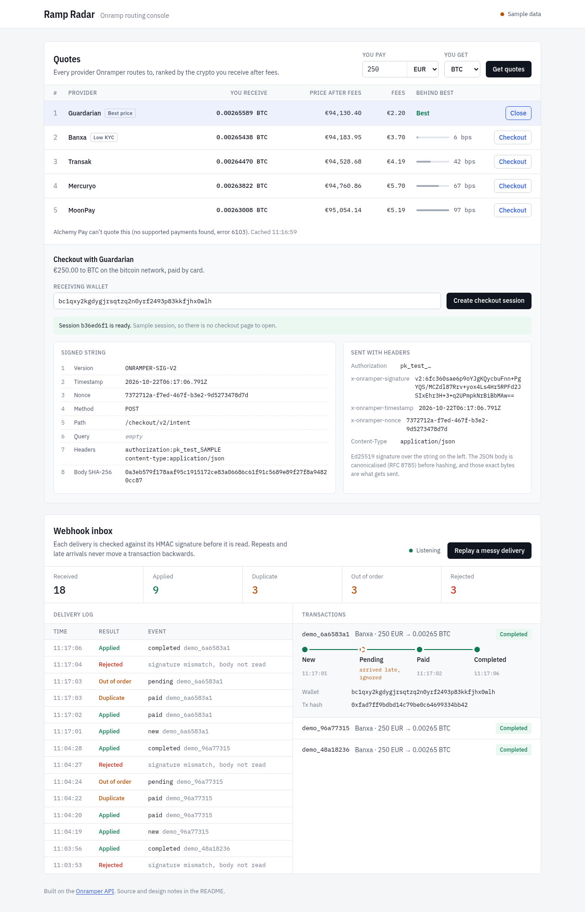

# Ramp Radar

A small TypeScript app built on the [Onramper API](https://docs.onramper.com):

- **Quotes.** Fetches buy quotes from every provider Onramper routes to and ranks them by the crypto actually received after fees. The gap to the best quote is shown in basis points.
- **Signed checkout.** Creates checkout intents signed with Onramper's [Signature V2](https://docs.onramper.com/docs/api-sign-requests-v2) (Ed25519 over an 8-part canonical string, RFC 8785 JSON). The UI shows each signed part so it can be checked against the docs.
- **Webhook inbox.** Verifies, de-duplicates and orders webhook deliveries so a transaction's state stays correct when deliveries are forged, repeated or late. Deliveries stream to the UI over server-sent events.



## Run it

Requires Node 22.13 or newer (for `node:sqlite`).

```bash
npm install
npm run dev      # UI on http://localhost:5173, API on :8787
```

Without an API key it runs on sample quotes. Signing and webhook handling are the real code paths either way. Click **Replay a messy delivery** to have the server send itself six signed webhooks over HTTP:

```
created                    -> 200 applied
payment received           -> 200 applied
redelivered "paid"         -> 200 duplicate
late "pending" arrives     -> 200 stale
forged "completed"         -> 401 Signature does not match
completed on-chain         -> 200 applied
```

`npm run demo:webhooks` sends the same sequence from a terminal.

To use Onramper's staging API, copy `.env.example` to `.env` and set `ONRAMPER_API_KEY` to a `pk_test_` key. Checkout also needs a signing key: run `npm run keys` and register the public half with Onramper.

| Script                       | What it does                                     |
| ---------------------------- | ------------------------------------------------ |
| `npm run check`              | Format check, lint, type check and tests (as CI) |
| `npm test`                   | Vitest suite                                     |
| `npm run build && npm start` | Production build, served by the API on :8787     |

## How it handles failure

| Failure                                       | Handling                                                                                                                      | Code                                  |
| --------------------------------------------- | ----------------------------------------------------------------------------------------------------------------------------- | ------------------------------------- |
| Forged webhook                                | HMAC-SHA256 over the raw body with a constant-time compare; 401 otherwise.                                                    | `server/onramper/webhook.ts`          |
| Webhook delivered twice                       | `UNIQUE (transaction_id, status)` on the event log makes the repeat a no-op. It still gets 200, so the sender stops retrying. | `server/transactions/store.ts`        |
| Webhook arrives late (`pending` after `paid`) | Statuses only move forward and terminal statuses never change. The late event is kept as `stale` for the audit trail.         | `server/transactions/stateMachine.ts` |
| Later event leaves out a field                | `COALESCE` keeps the known value (the hash only arrives on completion; the provider only on creation).                        | `server/transactions/store.ts`        |
| Signed body differs from the sent body        | The canonical bytes that were hashed are the bytes sent.                                                                      | `server/onramper/client.ts`           |
| Onramper slow, down or erroring               | 5 s timeout and a short 502. The upstream body is logged, not passed to the browser. Quotes are cached for 30 s.              | `server/onramper/client.ts`           |
| Provider can't quote                          | Listed separately with Onramper's error id (e.g. 6103), never ranked.                                                         | `server/lib/rankQuotes.ts`            |
| Malformed or oversized request body           | 400 or 413 with a readable message, never a 500.                                                                              | `server/http/middleware.ts`           |
| Checkout abuse                                | Zod validation, 10 requests a minute per IP, and the buyer's IP only leaves as a SHA-256 hash.                                | `server/http/routes/checkout.ts`      |
| Bad configuration                             | The environment is validated at startup; the process refuses to start with a readable error.                                  | `server/config.ts`                    |

## Design decisions

- **One contract for both sides.** `shared/api.ts` holds every request and response type. The server routes and the React components import it, so changing a response shape breaks the type check on both ends.
- **Same interface for live and sample data.** `createLiveClient` and `createMockClient` both implement `OnramperClient`. The mock signs requests with a throwaway Ed25519 key instead of skipping the signing step.
- **SQLite through `node:sqlite`.** No native build step and no extra dependency. Read, decide and write share one `BEGIN IMMEDIATE` transaction, and WAL plus `busy_timeout` keep it correct if a second process opens the same file.
- **Server-sent events, not WebSockets.** The browser only listens, so one-way SSE is enough, needs no library, and reconnects on its own.
- **Basis points for quote gaps.** Quotes usually sit within 1% of each other. A percentage like "−0.36%" is hard to compare at a glance; "36 bps" is the unit trading desks use for exactly this.

## Layout

```
shared/api.ts              HTTP contract used by server and web
server/
  index.ts                 wiring, static UI, graceful shutdown
  config.ts                env validation; live vs sample mode
  http/                    app, middleware (request IDs, rate limit, errors), schemas, routes/
  onramper/                Signature V2, RFC 8785 JSON, webhook HMAC, API client (live + mock)
  transactions/            state machine, SQLite store, in-memory delivery log
  demo/scenario.ts         the messy delivery, shared by the UI button and the CLI script
web/src/                   React UI: components/, hooks/, lib/
test/                      one file per module, plus HTTP tests against a real server
```

## Limitations

- Live checkout follows the documented request format but hasn't been run against Onramper, which needs a partner key.
- One process: the rate limiter, quote cache and delivery log live in memory. With several instances I'd move them to Redis and put webhook processing behind a queue with a dead-letter queue.
- Status ordering follows the documented lifecycle. If Onramper ever sent `failed → completed` (a retried payment, say), the state machine would need an explicit rule for it.
